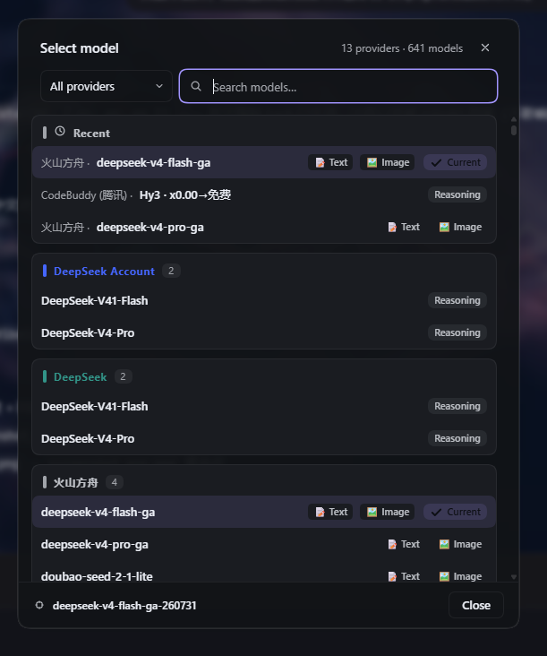
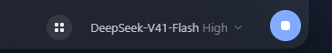

# dsh-model-picker · Model Quick Picker (DeepSeek Harness plugin)

[English](README.en.md) | [简体中文](README.md)

Adds a small button to the **left of the model dropdown** in the bottom-right of a
DeepSeek Harness session window. Clicking it opens a full model-selection popover:
grouped by provider, with live search, provider filtering, real capability tags,
reasoning badges and highlight of the currently selected model — loading, failure
and session-occupied states are all clearly presented.
**The selection writes back to the native model dropdown and takes effect
immediately**, because it shares the exact same per-session model directory and
`selectModel` submission path as the native dropdown ("switch on either side,
the other updates instantly").

## Screenshots





- **Trigger button**: 28px circular icon button, placed flush to the left of the
  model dropdown, styled like the "＋" button in the composer toolbar (hover /
  focus ring / disabled states all included).
- **Selection window** (centered modal, themed with CSS variables, adapts to
  light/dark themes):
  - **Header**: title + provider/model count + close;
  - **Provider filter**: custom dropdown to the left of the search box (all
    providers / a single provider), rendered with theme colors (no native
    `<select>`, avoiding a glaring system panel under dark themes);
  - **Search**: fuzzy match on model name / model id / provider name, ↑↓ to move
    the highlight, Enter to select, Esc to close;
  - **List**: grouped by provider (DeepSeek account / official first), groups with
    a color bar and a count badge; each row shows the **full model name** +
    **capability tags** + a "reasoning" badge + a "current" badge + a selection check;
  - **Footer**: current model summary + close button;
  - **States**: loading (spinner), load failure (retry), per-provider load failure
    (individual messages), current model no longer routable (warning), session busy
    (dedicated copy).

### Capability tags are real data

The inline `📝 text` / `🖼️ image` tags are **not** guessed from model description
text — they are read from the `input` lists **declared in the user's own config**
(pi-ai provider config, e.g. `providers.<id>.models[].input: [text, image]`).
The implementation reads the settings document through DSH's existing `settings`
Remote and scans `providers → models[].input` across namespaces to build an index;
providers without an `input` field in config show no tags (an honest reflection of
config, no guessing). Add or remove `input` in config and the tags update
accordingly.

> **Contract note (verified)**: tags are looked up by `group.id`, which shares a
> namespace with the **provider config keys** in settings (DSH's modelCatalog uses
> `provider.id` as the group id and `provider.name` as the display name). So a
> config key like `providers.volcengine-agent-plan` is matched reliably; should a
> future DSH change this naming contract, the tags silently disappear (no error)
> while the rest of the plugin keeps working.

## How it works

1. Registers into the **`conversation.input.right`** slot of the composer — an
   official extension point with `kind: list`, `scope: session`. The composer bar
   renders this slot before the model seat (`conversation.input.model`), so the
   button naturally appears to the **left** of the model dropdown.
2. `ctx.inject(['slots', 'modelDirectories'], …)` provides
   `ctx.modelDirectories` (the shared service registered by
   `@deepseek-ai/dsh-client-ui-model-selection`), resolving to the **same**
   `ModelDirectory` instance the native dropdown uses for the current session.
3. Selecting a model in the popover calls
   `directory.select({ provider, model, reasoningEffort })` → the exact same
   `selectModel` RPC as the native dropdown. On success the shared store updates,
   the native dropdown label **writes back automatically** and the session model
   switch takes effect immediately.
4. Capability tags are read via the `settings` Remote injected by
   `ctx.inject(['…', 'remote', 'remote.settings'])`:
   `settings.describe()` returns the merged config across namespaces, from which
   `provider → model → input[]` is extracted. Note that **`remote.<namespace>`
   must be explicitly listed in the inject array** (a cordis rule) — injecting
   only the root `remote` raises
   `cannot get property "remote.settings" without inject` on access.
5. Subagent-addressed sessions have no model directory, so the button hides
   automatically.

## Installation

Works with both the **web and desktop** profiles (a `platform: web` plugin takes
effect in both).

### Method A: git clone, then install locally (recommended)

```sh
git clone https://github.com/faxble/dsh-model-picker.git
dsh plugin --profile web add /path/to/dsh-model-picker
```

Replace `/path/to/dsh-model-picker` with your actual clone path; for the desktop
app, just swap `web` for `desktop`:

```sh
dsh plugin --profile desktop add /path/to/dsh-model-picker
```

After installing, restart DeepSeek Harness and enable `dsh-model-picker` under
Settings → Plugins, or confirm it was auto-enabled.

### Method B: Install directly from GitHub (no clone)

```sh
dsh plugin --profile web add github:faxble/dsh-model-picker
```

### Method C: Add manually to the profile (developer/debug use)

1. In the profile (default `%USERPROFILE%\.dsh\profiles\desktop`) `package.json`:
   - add `"dsh-model-picker": "file:D:\\Dev\\VibeCoding\\dsh-model-picker"` to
     `dependencies`;
   - add `"dsh-model-picker"` to `dsh.profile.bundles`.
2. Run `pnpm install` in the profile directory.
3. Restart DeepSeek Harness.

## Project structure

```
dsh-model-picker/
├── package.json        # package metadata + dsh.client declaration (platform: web)
├── index.js            # host half (no-op, just carries the bundle line)
├── cordis.patch.yml    # bundle patch: a one-line insert (name is the bare package name)
├── client.js           # browser half: ModuleLoader bundle (built from src/)
├── install.ps1         # install script (web / desktop)
├── src/                # source (ES modules, for development)
│   ├── dict.js         #   zh/en copy dictionaries
│   ├── pure.js         #   pure logic: sorting / search scoring / MRU / tags (unit-tested)
│   ├── style.js        #   CSS (theme tokens)
│   ├── icons.js        #   inline SVG icons
│   └── entry.js        #   ModuleLoader bundle entry (component + apply)
├── scripts/build.mjs   # esbuild bundler
├── test/               # node:test unit tests
└── README.md
```

## Notes

- Pure frontend plugin: **no runtime build step, no runtime dependencies** (only
  the `react` already provided by the shell); all colors come from DSH theme CSS
  variables, and switching light/dark themes needs no reload. `client.js` is a
  build artifact generated from `src/` via `pnpm build`.
- Modifies no DSH core code; `conversation.input.right` currently has no other
  consumers, so registering it shadows nothing.
- UI copy is **bilingual (zh / en)** and follows the DSH system language
  automatically — non-Chinese users can use it as-is.
- Extras: **recently-used (MRU) section pinned on top**, **ranked search**
  (exact > prefix > substring), a **reasoning-effort picker**, **lazy rendering**
  for large model lists, and accessibility support (focus trap, focus restore,
  aria-live, keyboard navigation).
- Theme note: **do not use `--dsw-alias-brand-text` for selected-row text color**
  — its semantics is "text **on** the brand color block" (designed for light
  themes); under dark themes it resolves to a dark color that becomes unreadable
  on a soft highlight. Use `--dsw-alias-label-primary` for text.

## Development & debugging

- After editing `src/`, run `pnpm build` to regenerate `client.js`, then copy it
  into the profile to trigger an HMR hot reload (no page refresh needed — DSH
  detects the file change and reloads the bundle):

  ```powershell
  pnpm build
  Copy-Item .\client.js $env:USERPROFILE\.dsh\profiles\desktop\node_modules\dsh-model-picker\client.js -Force
  ```

- Unit tests: `pnpm test` (`node --test`, covers the pure logic in `src/pure.js`).
- Build check: `pnpm check` (`node --check` on artifacts). **CI fails if the
  committed `client.js` is stale** — always build after editing `src/`.
- For source edits to take effect instantly (no copying), install with a `link:`
  symlink instead.
- To remove the plugin: uninstall `dsh-model-picker` under DSH Settings → Plugins.
