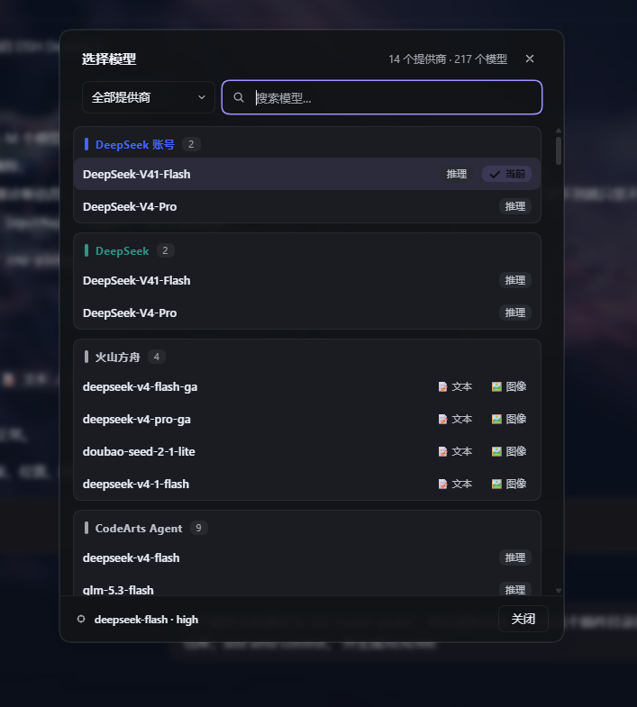

# dsh-model-picker · 模型速选器（DeepSeek Harness 插件）

[简体中文](README.md) | [English](README.en.md)

在 DeepSeek Harness 会话窗口右下角 **模型下拉框的左侧** 添加一个小按钮。
点击按钮弹出全量模型选择窗口：按提供商分组、实时搜索、提供商筛选、
真实能力标签、推理徽章、当前选中高亮，加载 / 失败 / 会话占用等状态都有清晰呈现。
**选择模型后立即回写模型下拉框并生效** —— 因为它与原生下拉框共用同一条
per-session 模型目录与 `selectModel` 提交路径（"任一端切换，另一端立刻显示"）。

## 效果




- **触发按钮**：28px 圆形图标按钮，紧贴模型下拉左侧，与 composer 工具栏
  「+」按钮同风格（悬停 / 焦点环 / 禁用态齐全）。
- **选择窗口**（居中弹窗，主题变量配色，深浅色主题自适应）：
  - **头部**：标题 + 提供商/模型计数 + 关闭；
  - **提供商筛选**：搜索框左侧的自定义下拉（全部提供商 / 单个提供商），
    跟随主题渲染（不用原生 `<select>`，避免深色主题下系统面板惨白）；
  - **搜索**：模型名 / 模型 id / 提供商名模糊匹配，↑↓ 移动高亮、Enter 选中、Esc 关闭；
  - **列表**：按提供商分组（DeepSeek 账号 / 官方优先），分组带色条与计数徽章，
    每行显示 **完整模型名** + **能力标签** + 「推理」徽章 + 「当前」徽章 + 选中勾；
  - **底部**：当前模型摘要 + 关闭按钮；
  - **状态**：加载中（spinner）、加载失败（重试）、提供商加载失败（逐条提示）、
    当前模型已不可路由（警告）、会话被占用（专用文案）。

### 能力标签是真实数据

行内的 `📝 文本` / `🖼️ 图像` 标签**不是**从模型描述文字里猜的，而是读
**用户自己配置里声明的 `input` 列表**（pi-ai 提供商配置，如
`providers.<id>.models[].input: [text, image]`）。实现走 DSH 已有的
`settings` Remote 读取 settings 文档，扫描各命名空间的 `providers → models[].input`
建索引；配置里没写 `input` 的提供商就不显示标签（如实反映配置，不做臆测）。
增删配置里的 `input`，标签随之变化。

## 工作原理

1. 注册进 composer 的 **`conversation.input.right`** slot —— 这是一个
   `kind: list`、`scope: session` 的官方扩展点，composer 栏在渲染模型
   seat（`conversation.input.model`）之前渲染它，因此按钮天然出现在
   模型下拉的**左边**。
2. 通过 `ctx.inject(['slots', 'modelDirectories'], …)` 拿到
   `ctx.modelDirectories`（由 `@deepseek-ai/dsh-client-ui-model-selection`
   注册的共享服务），对当前会话解析出与原生下拉**同一个**
   `ModelDirectory` 实例。
3. 弹窗里选择模型 → `directory.select({ provider, model, reasoningEffort })`
   → 走与原生下拉完全相同的 `selectModel` RPC。成功后共享 store 更新，
   原生模型下拉的标签**自动回写**，会话模型切换立即生效。
4. 能力标签由 `ctx.inject(['…', 'remote', 'remote.settings'])` 注入的
   `settings` Remote 读取：`settings.describe()` 返回各命名空间的合并配置，
   从中提取 `provider → model → input[]`。注意 **`remote.<namespace>` 必须显式
   写进 inject 列表**（cordis 规则），只注入根 `remote` 会在访问时报
   `cannot get property "remote.settings" without inject`。
5. 子代理（subagent addressed）会话没有模型目录，按钮自动隐藏。

## 安装

支持 **web 与 desktop** 两个 profile（`platform: web` 的插件在两者中均生效）。

### 方式 A：git clone 后本地安装（推荐）

```sh
git clone https://github.com/faxble/dsh-model-picker.git
dsh plugin --profile web add /path/to/dsh-model-picker
```

把 `/path/to/dsh-model-picker` 换成实际 clone 路径；桌面版把 `web` 换成
`desktop`：

```sh
dsh plugin --profile desktop add /path/to/dsh-model-picker
```

安装后重启 DeepSeek Harness，在「设置 → 插件」中启用 `dsh-model-picker`，
或确认它已自动启用。

### 方式 B：远程直接安装（免 clone）

```sh
dsh plugin --profile web add github:faxble/dsh-model-picker
```

### 方式 C：手动加入 profile（开发者调试用）

1. 在 profile（默认 `%USERPROFILE%\.dsh\profiles\desktop`）的 `package.json` 中：
   - `dependencies` 增加 `"dsh-model-picker": "file:D:\\Dev\\VibeCoding\\dsh-model-picker"`；
   - `dsh.profile.bundles` 增加 `"dsh-model-picker"`。
2. 在 profile 目录执行 `pnpm install`。
3. 重启 DeepSeek Harness。

## 目录结构

```
dsh-model-picker/
├── package.json        # 包元数据 + dsh.client 声明（platform: web）
├── index.js            # Host 半身（no-op，仅承载 bundle 行）
├── cordis.patch.yml    # bundle patch：一行 insert（name 为裸包名）
├── client.js           # 浏览器半身：ModuleLoader bundle（全部 UI）
├── install.ps1         # 安装提示脚本
└── README.md
```

## 说明

- 纯前端插件：**无构建步骤、无运行时依赖**（只用 shell 已提供的 `react`），
  全部颜色来自 DSH 主题 CSS 变量，切换深浅色主题无需重载。
- 不修改任何 DSH 核心代码；`conversation.input.right` 目前没有任何占用者，
  注册不会遮蔽既有 UI。
- 界面文案**中英双语**，随 DSH 系统语言自动切换（zh / en），外国用户可直接使用。
- 主题取值注意：**不要用 `--dsw-alias-brand-text` 做选中行文字色** ——
  它的语义是"品牌色块**上**的文字"（浅色主题设计值），深色主题下解析为深色，
  配软高亮底会变成黑字看不清；文字统一用 `--dsw-alias-label-primary`。

## 开发调试

- `file:` 安装会把插件目录内容**复制**进
  `%USERPROFILE%\.dsh\profiles\desktop\node_modules\dsh-model-picker`；
  改源码后把 `client.js` 复制过去即可触发 HMR 热更新（页面无需刷新，
  DSH 会检测到文件变更并重新加载 bundle）：

  ```powershell
  Copy-Item .\client.js $env:USERPROFILE\.dsh\profiles\desktop\node_modules\dsh-model-picker\client.js -Force
  ```

- 改完务必先 `node --check client.js`：这是手写 bundle，语法错误会让整个
  bundle 加载失败（按钮直接消失）。特别注意 **CSS 模板字符串里不能出现反引号**，
  否则模板被提前截断，后续 CSS 会被当 JS 解析。
- 若要源码改动即时生效（免复制），改用 `link:` 符号链接方式安装。
- 移除插件：DSH「设置 → 插件」里卸载 `dsh-model-picker` 即可。
